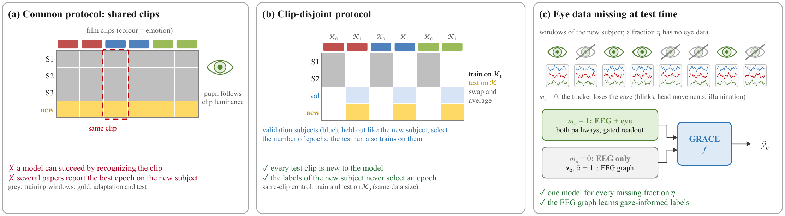
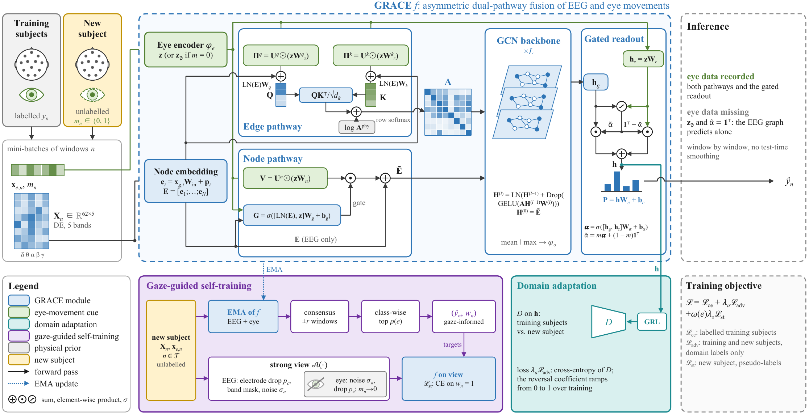
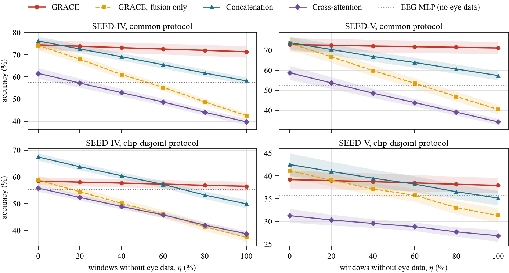

# GRACE

### Stimulus Shortcuts in Cross-Subject EEG–Eye Movement Emotion Recognition

Peijun Shi&#42;, Xiujin Zhu&#42;, Zhenguo Lao, Chee-Onn Chow, Wei Ru Wong, Sin Hui Ng, Xiaobing Jiang

Universiti Malaya · Huazhong University of Science and Technology

&#42; Equal contribution

> **Code, clip splits, data loaders and the per-run results will be released once the paper is accepted.** Watch or star this repository to be notified.

## Overview

Cross-subject emotion recognition from EEG and eye movements reports accuracies above 90% on SEED, SEED-IV and SEED-V. In these benchmarks every test subject watches the film clips used for training, the epoch is often selected on the test subject, and every window is assumed to carry eye data. Eye-movement features follow the luminance and the layout of each clip, so a model can be correct because it recognizes the clip.

This work evaluates EEG–eye movement fusion under the conditions of deployment and measures what eye movements teach an EEG model.

- **Clip-disjoint evaluation protocol** separates subjects and film clips. A same-clip control with identical training data isolates clip recognition, validation subjects select the number of epochs, and a controlled fraction of the test windows loses its eye data. The protocol is applied to the released code of UF-AMA and to models that isolate each modality and each fusion design.
- **GRACE** (Gaze-guided Robust Asymmetric fusion for Cross-subject Emotion recognition) probes cross-modal supervision. Its fusion network follows CTD-GNet and keeps EEG as an electrode graph that the eye movements reshape through electrode-specific edge prompts, gated node injections and a gated readout. A learned missing-eye path returns the network to the graph, and gaze-guided self-training trains this path on the new subject with labels derived from their eye movements.

  

  

## Highlights

- **Reported accuracies depend on test-subject epoch selection and shared clips:** the released UF-AMA code reproduces its reported accuracy only with the best test epoch, and on unseen clips its final accuracy falls by 14.6, 10.4 and 32.0 points on SEED, SEED-IV and SEED-V.
- **Test-subject epoch selection inflates every evaluated model** by 2.6 to 15.5 points, and more on unseen clips than on shared ones.
- **The clip shortcut lies in the eye movements:** on unseen clips the eye-movement features retain 42.0–76.3% of their same-clip accuracy and EEG 62.9–98.1%, yet fusion still exceeds EEG alone by 12.1 and 6.8 points on SEED-IV and SEED-V.
- **Feature concatenation matches or exceeds UF-AMA** on every dataset at one thirtieth of its training time.
- **Cross-modal supervision inherits the clip shortcut:** gaze-guided self-training lifts the EEG route of GRACE by 14.0 and 18.4 points on seen clips of SEED-IV and SEED-V and by 1.1 and 2.2 points on unseen clips.
- **One network for every fraction of missing eye data:** without eye data GRACE retains 95.8–98.0% of its accuracy and never falls significantly below an EEG-only model, whereas fusion networks trained with complete eye data fall up to 18 points below it.

## Results

### UF-AMA under four protocols

Accuracy (%) of the released UF-AMA code, mean over leave-one-subject-out folds. Best test epoch: the highest test accuracy over 400 epochs, the rule of the released code.

| Protocol | Epoch | SEED | SEED-IV | SEED-V |
|:--|:-:|:-:|:-:|:-:|
| Reported in the UF-AMA preprint | best test epoch | 94.53 | 92.73 | – |
| Per-session (original protocol) | best test epoch | 95.98 | 92.17 | 94.48 |
| Per-session (original protocol) | final | 85.60 | 82.70 | 85.90 |
| Common (all sessions) | final | 82.19 | 72.06 | 69.72 |
| Same-clip half | final | 84.42 | 73.26 | 75.26 |
| **Clip-disjoint** | final | **69.87** | **62.90** | **43.24** |

### Missing eye data

Accuracy (%) when every test window loses its eye data, final epoch. EEG MLP: EEG-only model with the same adaptation. Bold: best fusion network.

| Method | SEED, common | SEED, clip-disjoint | SEED-IV, common | SEED-IV, clip-disjoint | SEED-V, common | SEED-V, clip-disjoint |
|:--|:-:|:-:|:-:|:-:|:-:|:-:|
| Feature concatenation | 76.08 | **67.41** | 58.17 | 49.95 | 57.37 | 35.16 |
| Cross-modal attention | 68.33 | 57.20 | 39.72 | 38.79 | 34.29 | 26.88 |
| GRACE, fusion network only | 64.96 | 59.99 | 42.49 | 37.44 | 40.49 | 31.34 |
| **GRACE** | **77.94** | 65.30 | **71.33** | **56.53** | **71.11** | **37.92** |
| EEG MLP (no eye data) | 77.91 | 66.39 | 57.56 | 55.41 | 52.31 | 35.68 |

  

### What gaze-guided self-training transfers

The same-clip and clip-disjoint halves share their training data and differ only in whether the test clips appear in training. Accuracy (%), final epoch; \*\*\*: Holm-adjusted *p* < 0.001.

| | SEED-IV, seen clips | SEED-IV, unseen clips | SEED-V, seen clips | SEED-V, unseen clips |
|:--|:-:|:-:|:-:|:-:|
| Gaze-informed pseudo-labels, all windows | 74.2 | 60.7 | 78.2 | 40.4 |
| GRACE without eye data (EEG route) | 70.5 | 56.5 | 75.1 | 37.9 |
| EEG MLP with domain adaptation | 56.5 | 55.4 | 56.7 | 35.7 |
| **Gain of the EEG route** | **+14.0\*\*\*** | +1.1 | **+18.4\*\*\*** | +2.2 |

## Release plan

- [ ] Clip-disjoint protocol: clip splits, validation subjects and data loaders for SEED, SEED-IV and SEED-V
- [ ] Training and evaluation code for GRACE and all baselines
- [ ] Data loader and scripts that run the released UF-AMA code under all protocols
- [ ] Per-run result files of all 5,795 runs and the scripts that regenerate every table and figure

## Citation

The BibTeX entry will be added when the paper is published.

## Acknowledgements

GRACE builds on the fusion network of [CTD-GNet](https://github.com/Peijun1122/CTD-GNet) and uses the [SEED, SEED-IV and SEED-V](https://bcmi.sjtu.edu.cn/home/seed/) datasets of the BCMI laboratory at Shanghai Jiao Tong University. The audit runs the released code of [UF-AMA](https://github.com/BetterCoderLab/UF-AMA). We thank their authors for releasing their code and data.

## Contact

For questions, please open an issue in this repository.
